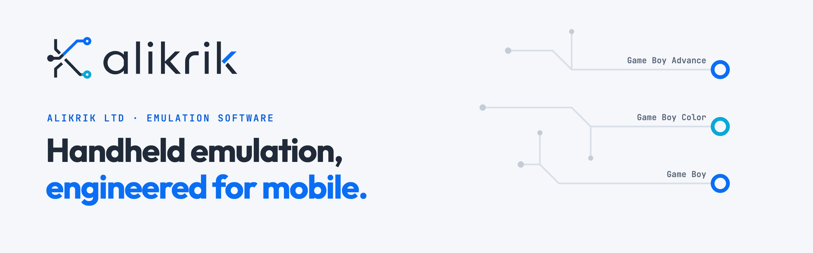
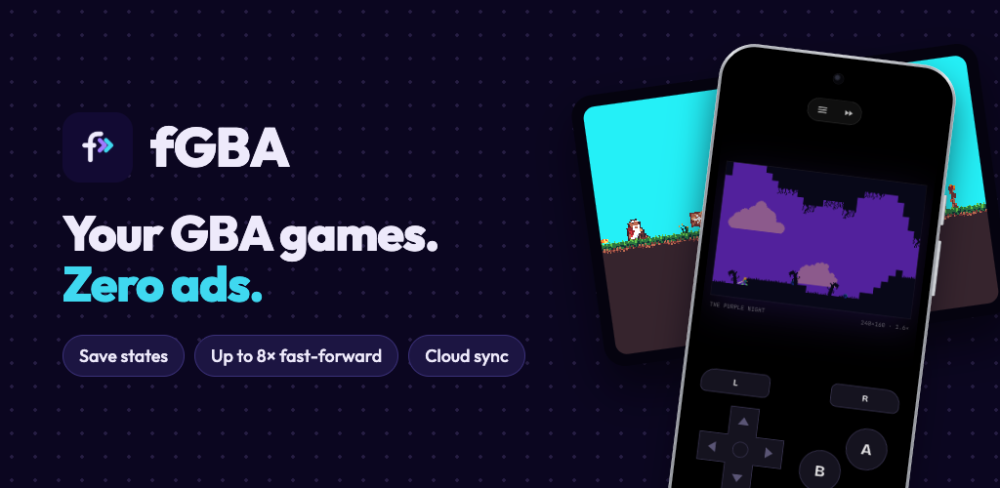

<picture>
  <source media="(prefers-color-scheme: dark)" srcset="https://github.com/alikrik/.github/raw/main/profile/assets/banner-dark.png">
  
</picture>

  <a href="https://alikrik.com">alikrik.com</a> ·
  <a href="https://alikrik.com/fgba/">fGBA</a> ·
  <a href="https://alikrik.com/#company">The company</a>

Alikrik Ltd develops emulation software for Android, bringing classic handheld systems to modern phones with touch and controller support. We concentrate on a small number of products, designed around touchscreens and controllers and maintained for the long term.

## fGBA

**Game Boy Advance, Game Boy and Game Boy Color on Android.** Built on Archie, our own emulation core, with an interface designed for phones from the outset. Free to download, with a one-time Pro upgrade. No advertising in either edition.

| | Free | Pro |
|---|---|---|
| Save-state slots | 2 | 12 |
| Fast-forward | up to 2× | 3×, 4×, 8× and unlimited |
| Physical controllers | — | yes, with remapping |
| Touch controls, battery saves, settings | yes | yes |
| Box art for recognised games | yes | yes |
| Ads | none | none |

Coming soon to Google Play. More at **[alikrik.com/fgba](https://alikrik.com/fgba/)**.

## How we work

| Engineering first | Transparent by default | Long-term support |
|---|---|---|
| We ship fewer products and hold each one to a high bar for performance, stability and polish. | Clear one-time pricing, no dark patterns, and user data kept on the device wherever possible. | Every release is tested thoroughly and maintained after launch, so the software you install keeps working. |

---

© Alikrik Ltd, registered in England and Wales, company <a href="https://find-and-update.company-information.service.gov.uk/company/17492615">17492615</a> · <a href="https://alikrik.com/fgba/privacy/">fGBA privacy policy</a> 
The fGBA image shows The Purple Night and The Hat Chooses the Wizard by Gwilym Inzani and Corwin Kuiper, whose art is <a href="https://creativecommons.org/licenses/by-sa/4.0/">CC BY-SA 4.0</a>, so the image is CC BY-SA 4.0 too.
